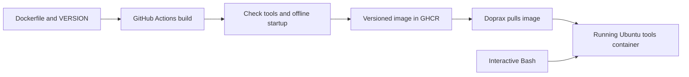

# Ubuntu tools on Doprax

Ubuntu 26.04 with curl, wget, net-tools, nmap, iftop, mtr-tiny, speedtest,
Bash, bash-completion, htop, btop, and your `my-shell` Bash configuration.
Packages and shell configuration are installed when the image is built.
Container startup only runs `sleep infinity`: no APT or installer downloads.



## Build and publish

The intended image is `ghcr.io/hamidnaeemabadi/doprax-service:v0.1.0`.
Its semantic version comes from [VERSION](VERSION). The workflow also publishes
an image tagged `sha-<full-commit>`. Builds target `linux/amd64` for the cloud host.

Push this project to `hamidnaeemabadi/doprax-service` on GitHub. The
[Publish container image](.github/workflows/publish-image.yml) workflow runs when
Dockerfile, VERSION, Docker ignore rules, or the workflow changes on `main`.
It can also be run manually from the Actions tab. It uses the repository's
`GITHUB_TOKEN` with `packages: write`; no additional registry secret is needed.
The image name follows the repository owner/name, so update Compose if the
repository is created elsewhere.

After the first successful publish, open the package settings on GitHub and set
its visibility to **Public**. [GitHub packages default to private](https://docs.github.com/en/packages/working-with-a-github-packages-registry/working-with-the-container-registry),
and [Doprax App Space requires public images](https://www.doprax.com/docs/app-space/).

For each release, increment VERSION and update the matching tag in compose.yml.
Use a new version for each changed image; avoid republishing an existing version.
For strict immutability, use the published `@sha256:...` digest in Compose.
The installer follows `my-shell/main` at build time. External changes require
an uncached rebuild and a new version; manually rerunning the workflow may reuse
cached installation layers.

To build and publish manually with Docker Desktop running and a GHCR login:

```bash
docker buildx build --platform linux/amd64 --pull \
  -t ghcr.io/hamidnaeemabadi/doprax-service:v0.1.0 --push .
```

The Dockerfile runs the requested installer before APT cleanup, selecting Bash
explicitly. It runs as root and downloads configuration during the build.
Recommended APT packages are excluded and APT caches are removed.

Size optimizations exclude package manuals, Info pages, documentation (while
retaining copyright notices), Lintian metadata, and translated messages before
installation. APT translation downloads are disabled. Build cleanup also removes
logs, temporary files, installer backups, and Python bytecode caches; Python is
configured not to recreate bytecode caches. These operations share the install
layer, so discarded installation files do not remain in an earlier layer.
Command help, Nmap scripts/databases, terminal data, Bash completion, and APT/dpkg
remain available. Localized messages and offline manuals are intentionally omitted.

## Deploy

After the image has been published and made public, paste [compose.yml](compose.yml)
into the Doprax App Space **Compose** tab. Applying Compose replaces the App
Space's configuration; check the selected App Space first. No port exposure or
HTTP health check is needed for this shell toolbox.

On a Doprax VM or local Docker host:

```bash
docker compose pull
docker compose up -d
docker compose exec ubuntu-tools /bin/bash
```

The first deployment downloads the built image. Restarts reuse it and install
nothing. Run `docker compose pull` followed by `docker compose up -d` after
updating the version. To roll back, restore the previous image tag and run those
commands again. To remove the container, run `docker compose down`.

In App Space, use the container terminal/command facility, where available, to
open `/bin/bash`. There is no SSH server or web terminal in the image.

## Tools and limitations

```bash
curl --version
wget --version
ifconfig
nmap --version
iftop -p -i eth0
mtr --report --report-cycles 5 example.com
speedtest --secure
htop
btop
```

`speedtest` comes from Ubuntu's Python `speedtest-cli` package. Bash completion
uses the `bash-completion` package. Shell configuration covers Bash; optional
tmux/Zsh components and their dependencies are not added to this minimal image.

The container runs as root for network diagnostics and requests `NET_RAW`.
Doprax's capability policy has not been verified. Use `iftop -p` to avoid
promiscuous mode, or `nmap -sT` where raw sockets are restricted. Monitoring
shows the container's network/process visibility, not the entire cloud host.
Container changes are ephemeral on replacement; no volume is configured.

## Validation status

Local `linux/amd64` builds succeeded before and after size optimization.
Docker-reported local image size fell from 292,314,770 to 273,051,274 bytes
(19.3 MB / 6.6%). These are local image sizes, not GHCR download sizes.

Compose parsing, workflow YAML parsing, and embedded Bash syntax passed.
Runtime smoke checks passed for tool availability, version commands, Nmap script
data, Bash completion initialization, shell configuration files, and startup with
network access disabled. The same checks are included in the publish workflow.
The redundant `.bash_completion` initialization was removed because `my-shell`
already enables completion; re-sourcing it there caused recursive initialization.
The optimized image is available locally as `doprax-service:size-after`.
Registry publication and Doprax deployment remain unverified.
